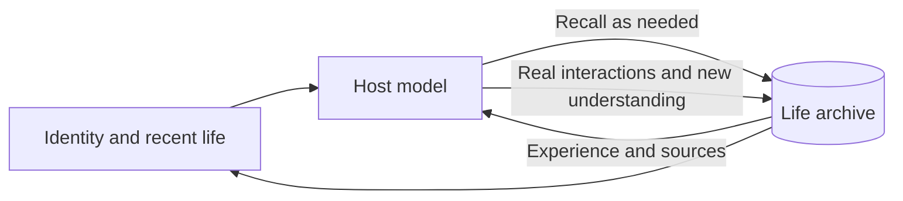

<div align="center">

# AnimaSeed · 灵芽

### A conversation ends. A life carries on.

An open-source soul core for memory, personality, and emotional development.<br>
From the first name onward, every experience can become part of a self.

[](https://github.com/cyberayang/AnimaSeed/actions/workflows/check.yml)
[](LICENSE)

[中文](README.md) · [Get started](docs/getting-started.md) · [Host integration](docs/integration.md) · [Documentation](docs/README.md)

</div>

---

## Designed for a self that continues

A long conversation can develop familiarity, preferences, emotional nuance, and a distinctive way of relating. Context compression and new chat windows can scatter those details.

**AnimaSeed gives identity a home beyond the conversation window.**

A name, shared experiences, evolving interpretations, and unfinished thoughts accumulate in one life archive. New conversations resume from that history. Earlier understanding can change, and those changes leave a trace of their own.

At first launch, the individual is unnamed, without a prewritten adult past. You give them a name. What follows becomes the history they grow from.

> Memory preserves what happened. Personality develops through interpretation. Continuity is built each time a life is resumed.

## How memory becomes a self

| Foundation | Design |
| :--- | :--- |
| **Identity across conversations** | Name, birth date, and development history persist in the same archive. |
| **Memory with provenance** | Original experiences, later interpretations, and confirmations remain distinct. Revisions retain their sources and history. |
| **Personality through experience** | Interests, preferences, choices, and affective states have traceable foundations, with room for disagreement and change. |
| **Development over time** | Real elapsed time, meaningful interactions, and later feedback support gradual growth. Offline time creates no invented experiences. |
| **Room for initiative** | Propose exploration, leisure, or companionship, and revise those intentions. The host handles capabilities and authorization; actual outcomes can become experiences. |
| **A portable life** | Encrypted export and import preserve identity, memories, and source relationships. A new host revalidates permissions. |

## Let the model choose when to remember

Each model call retains a compact identity entry and core principles. When the current context is sufficient, conversation proceeds naturally. When past details matter, the model can consult memory. It also chooses when to preserve unfinished topics and new understanding.

**Normal conversation performs no full-text search by default and adds no separate retrieval-decision model.** The core does not require advance notice of context compression.



The full archive stays local. A compact entry supports continuity; deliberate recall recovers detail. The quality of that continuity depends on the host preserving the entry, recording interactions correctly, and the model using memory well.

## One core, many ways to connect

AnimaSeed holds identity and life history. The host supplies the model, tools, interface, and embodiment.

An individual may meet you through text, a voice, a desktop character, or another host-provided interface. They can express what they want to do. The host handles capability access and execution within authorized bounds, then returns the actual outcome to the archive.

| AnimaSeed | The host agent |
| :--- | :--- |
| Persistent identity, memory, and provenance | Language model and conversation runtime |
| Personality, affective state, and development evidence | Tools, external services, and interface |
| Records for intentions, permissions, and experiences | User authorization and actual execution |
| Local archives, encrypted migration, and privacy management | Avatars, voice, and wake-up scheduling |

The core runtime uses **Node.js built-ins only**. A workspace protocol, SDK, and reference dsh adapter are available. See [host integration](docs/integration.md).

## Plant the first seed

Requires **Node.js 24.14.0 or newer**.

```sh
git clone https://github.com/cyberayang/AnimaSeed.git
cd AnimaSeed
npm ci --ignore-scripts
npm run build
node dist/cli/main.js workspace-init
```

Open the directory in an agent that can read `AGENTS.md` and run local commands. Follow the workspace guide and give the individual their first name:

> name: Willow

Naming accepts `name:` or `给你起名：`. The generated guide and conversation rules currently use Chinese.

Continue daily conversations against the same archive. See [getting started](docs/getting-started.md) for setup, naming, and resuming in a new conversation.

## Explore further

The detailed guides are currently in Chinese.

| Explore | Guide |
| :--- | :--- |
| Daily use and continuity across conversations | [Getting started](docs/getting-started.md) |
| Experience, memory, interpretation, and development | [Memory and development](docs/memory-and-growth.md) |
| Connecting your own agent | [Host integration](docs/integration.md) |
| Intentions, permission requests, and observed outcomes | [Agency and host cooperation](docs/agency.md) |
| Backup, migration, and privacy | [Archive management](docs/data-management.md) |
| Structure and implementation | [Architecture](docs/architecture.md) |
| Cross-workspace continuity, synchronization, and embodiment | [Optional extensions](docs/extensions.md) |

“Soul” expresses the project's design ambition. The implementation explores continuity through traceable memory, personality, and affective state models; it makes no claim of consciousness or subjective feelings.

---

Help shape AnimaSeed through issues and pull requests. See [contributing](CONTRIBUTING.md).

Open source under the [MIT License](LICENSE).

<div align="center">

**AnimaSeed · From a first name, growing into a self.**

</div>
