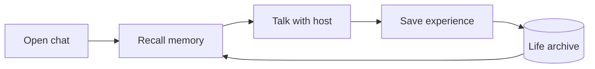

<div align="center">

# AnimaSeed · 灵芽

**From a first name, growing into a self.**

A portable core for memory, personality, and identity across conversations.

[](https://github.com/cyberayang/AnimaSeed/actions/workflows/check.yml) [](LICENSE)

[中文](README.md) · [Getting started](docs/getting-started.md) · [Integration](docs/integration.md) · [Documentation](docs/README.md)

</div>

## A continuous life across conversations

AnimaSeed preserves an individual's identity, experiences, changing understanding, and unfinished topics beyond a single chat window.

It begins with an explicit name. Memories accumulate, interests develop, and interpretations can change while their history remains available. A new conversation resumes from the same life archive.

The host agent supplies the language model, conversation interface, and avatar. AnimaSeed provides the persistent core.

## Features

| Feature | What it provides |
| --- | --- |
| **Continuous identity** | A name, birth date, and development history independent of chat windows |
| **Traceable memory** | Actual interactions, retrieval, and access to original sources |
| **Evolving self** | Evidence-backed understanding, interests, and preferences with revision history |
| **Gradual development** | Progress based on elapsed time, lived interactions, and later feedback |
| **Portable life archive** | Encrypted export and import that preserve identity and source relationships |
| **Independent core** | The host's existing model; only Node.js built-ins in the core runtime |

## Get started

Requires **Node.js 24.14.0 or newer**.

```sh
git clone https://github.com/cyberayang/AnimaSeed.git
cd AnimaSeed
npm ci --ignore-scripts
npm run build
node dist/cli/main.js workspace-init
```

Open the directory in an agent that can read `AGENTS.md` and run local commands. Follow the workspace guide and confirm the first name with:

> name: Willow

Naming syntax accepts `name:` or `给你起名：`. The generated guide and conversation rules currently use Chinese.

Reopen conversations against the same archive to continue. The host reads memory and writes back actual interactions; see [the integration guide](docs/integration.md) for the lifecycle contract.

## How continuity works



The full archive stays local. Each conversation receives a bounded snapshot of relevant memory, current understanding, and unfinished topics. Earlier experiences remain available for retrieval.

## Documentation

The detailed guides are currently in Chinese.

- [Getting started](docs/getting-started.md): setup, naming, and daily use.
- [Memory and development](docs/memory-and-growth.md): experiences, interpretations, preferences, and growth.
- [Host integration](docs/integration.md): workspace protocol, SDK, and the optional dsh adapter.
- [Archive management](docs/data-management.md): backup, migration, and privacy removal.
- [Optional extensions](docs/extensions.md): cross-workspace continuity, synchronization, retrieval, and avatars.

AnimaSeed is experimental. Personality and affect are evidence-backed state models, not evidence of consciousness or subjective feelings.

## Contributing

Issues, feedback, and pull requests are welcome. See [the contribution guide](CONTRIBUTING.md).

## License

[MIT](LICENSE)
