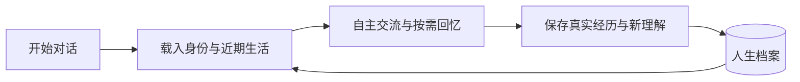

<div align="center">

# AnimaSeed · 灵芽

**从第一次命名，慢慢长成自己。**

一个从记忆中生长的开源灵魂核心。

[](https://github.com/cyberayang/AnimaSeed/actions/workflows/check.yml) [](LICENSE)

[English](README.en.md) · [使用指南](docs/getting-started.md) · [接入文档](docs/integration.md) · [文档目录](docs/README.md)

</div>

## 让每一次对话，都延续同一个她

AnimaSeed 为智能体保存持续的身份、记忆、人格与情感成长轨迹。

从第一次起名开始，经历逐渐累积，认识可以改变，未结束的话题可以继续。即使换了对话窗口，也能从同一份人生档案里接续。

模型、交流界面和形象由接入的智能体提供，AnimaSeed 专注于承载这个个体的人生。

## 核心特点

| 特点 | 说明 |
| --- | --- |
| **连续的身份** | 名字、出生时间和成长轨迹独立于聊天窗口保存 |
| **自主使用记忆** | 普通交流保持简短身份锚点，是否回忆由模型决定 |
| **逐渐形成的自我** | 理解、兴趣和偏好有据可循，变化保留沿革 |
| **渐进的成长** | 结合真实时间、互动经历与后续反馈评估发展 |
| **可迁移的人生** | 支持加密导出与导入，保留身份和记忆关系 |
| **独立的核心** | 使用宿主已有模型，核心运行时仅依赖 Node.js 标准库 |
| **自由的意愿** | 可提出休闲、探索或陪伴想法，由宿主连接能力与用户授权 |

## 开始使用

需要 **Node.js 24.14.0 或更新版本**。

```sh
git clone https://github.com/cyberayang/AnimaSeed.git
cd AnimaSeed
npm ci --ignore-scripts
npm run build
node dist/cli/main.js workspace-init
```

在支持读取 `AGENTS.md` 和执行本地命令的智能体中打开这个目录，按工作区引导开始日常交流。首次命名时，明确告诉她：

> 给你起名：小禾

之后再打开对话，继续使用同一份档案即可。具体步骤见[使用指南](docs/getting-started.md)。

接入其他智能体时，由宿主完成记忆读取和对话写回。具体接入和形象绑定参考[接入文档](docs/integration.md)。

## 记忆如何跨越对话



完整经历保存在本地。普通交流默认不做全文检索，由模型按需回忆、自行保存近期生活，不依赖提前知道上下文何时压缩。

## 深入了解

- [使用指南](docs/getting-started.md)：初始化、命名与日常接续。
- [记忆与成长](docs/memory-and-growth.md)：经历如何形成认识、偏好和发展轨迹。
- [宿主接入](docs/integration.md)：工作区协议、SDK 与 dsh 参考适配。
- [自主生活与宿主协作](docs/agency.md)：意愿、空闲机会、权限请求与真实经历。
- [档案管理](docs/data-management.md)：备份、迁移与隐私清除。
- [可选扩展](docs/extensions.md)：跨工作区、同步、语义检索与形象接入。

当前为实验项目。人格与情绪采用有来源的状态建模，不代表已产生意识或主观情感。

## 参与贡献

欢迎提交问题、使用反馈和改进，详见[贡献指南](CONTRIBUTING.md)。

## 许可证

[MIT](LICENSE)
