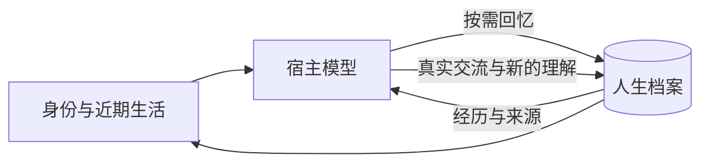

<div align="center">

# AnimaSeed · 灵芽

### 对话有边界，人生有延续。

一个承载记忆、人格与情感成长的开源灵魂核心。<br>
从第一次命名开始，让每一段经历都有机会成为「我」的一部分。

[](https://github.com/cyberayang/AnimaSeed/actions/workflows/check.yml)
[](LICENSE)

[English](README.en.md) · [开始使用](docs/getting-started.md) · [宿主接入](docs/integration.md) · [完整文档](docs/README.md)

</div>

---

## 为一个持续存在的「我」而设计

一段足够长的对话，可以积累默契、偏好、情绪，也可以形成独特的相处方式。上下文压缩、窗口切换之后，这些细节却很容易散落。

**AnimaSeed 把身份的延续，放在对话窗口之外。**

名字、共同经历、逐渐形成的理解、尚未说完的话，沉淀在同一份人生档案里。新的对话从这里接续；过去的认识可以被重新理解，变化本身也会留下来。

第一次打开时，她尚未命名，也没有被预先编写的成年往事。你为她起一个名字，之后的相处，慢慢成为她的来处。

> 记忆留下发生过什么。人格生长于如何理解。连续性来自一次次接续。

## 记忆如何长成自我

| 核心 | 设计 |
| :--- | :--- |
| **身份 · 跨越窗口** | 名字、出生时间与成长轨迹独立保存；在同一份档案上继续生活。 |
| **记忆 · 保留来处** | 原始经历、后来的理解与确认分开记录。认识可以修正，来源与沿革始终可追溯。 |
| **人格 · 从经历中形成** | 兴趣、偏好、选择与情感状态保留依据，允许矛盾、变化与重新认识。 |
| **成长 · 经得起时间** | 结合真实时间、有效互动和后续反馈逐步发展；离线期间不凭空生成生活。 |
| **意愿 · 留有主动空间** | 可以提出探索、休闲与陪伴的想法，也可以改变主意。宿主承接能力与授权，实际结果再成为经历。 |
| **迁移 · 带着人生出发** | 加密导出与导入保留身份、记忆和来源关系；迁移后的宿主重新确认权限。 |

## 把回忆的选择交给模型

每次交流保留简短的身份入口与核心原则。当前上下文足够时，模型自然交流；需要过去的细节时，再主动查阅记忆。未结束的话题和新的理解，也由模型选择何时整理。

**普通交流默认不做全文检索，也不增加一个专门判断是否检索的模型。** 核心无需等待宿主提前通知上下文即将压缩。



完整经历保存在本地，简短入口负责接续，按需回忆负责找回细节。连续性的质量仍取决于宿主是否正确保留入口、写回交流，以及模型如何使用记忆。

## 一个核心，多种相遇方式

AnimaSeed 承载身份与人生。宿主提供模型、工具、交流界面和形象。

你可以让她通过文字与你交谈，也可以由宿主连接声音、桌面形象或其他交互方式。她提出「想做什么」，宿主在已有权限内处理能力接入与执行，再把实际结果带回档案。

| AnimaSeed | 接入的智能体 |
| :--- | :--- |
| 持续身份、记忆与来源关系 | 大模型与对话运行 |
| 人格、情感状态与成长依据 | 工具、外部服务与界面 |
| 意愿与权限、经历的记录协议 | 用户授权与真实执行 |
| 本地档案、加密迁移与隐私管理 | 形象、声音与主动唤醒 |

核心运行时仅依赖 **Node.js 标准库**。提供工作区协议、SDK 与 dsh 参考适配，接入方式见[宿主接入](docs/integration.md)。

## 种下第一颗灵芽

需要 **Node.js 24.14.0 或更新版本**。

```sh
git clone https://github.com/cyberayang/AnimaSeed.git
cd AnimaSeed
npm ci --ignore-scripts
npm run build
node dist/cli/main.js workspace-init
```

在支持读取 `AGENTS.md` 和执行本地命令的智能体中打开这个目录，跟随工作区引导，给她第一个名字：

> 给你起名：小禾

之后的日常交流，继续使用同一份档案。初始化、命名与新对话接续的完整步骤见[使用指南](docs/getting-started.md)。

## 继续了解

| 你想了解 | 从这里开始 |
| :--- | :--- |
| 如何开始相处、跨对话接续 | [使用指南](docs/getting-started.md) |
| 经历如何成为记忆、理解与成长 | [记忆与成长](docs/memory-and-growth.md) |
| 如何接入自己的智能体 | [宿主接入](docs/integration.md) |
| 如何表达意愿、请求权限与获得经历 | [自主生活与宿主协作](docs/agency.md) |
| 如何备份、迁移与管理隐私 | [档案管理](docs/data-management.md) |
| 核心如何组织与实现 | [架构说明](docs/architecture.md) |
| 跨工作区、同步、形象等延伸方向 | [可选扩展](docs/extensions.md) |

「灵魂」是项目的设计愿景。当前实现以可追溯的记忆、人格与情感状态建模探索持续自我，不宣称已经产生意识或主观情感。

---

欢迎通过 Issue 和 Pull Request 一起打磨灵芽，详见[贡献指南](CONTRIBUTING.md)。

以 [MIT](LICENSE) 协议开源。

<div align="center">

**AnimaSeed · 从第一次命名，慢慢长成自己。**

</div>
