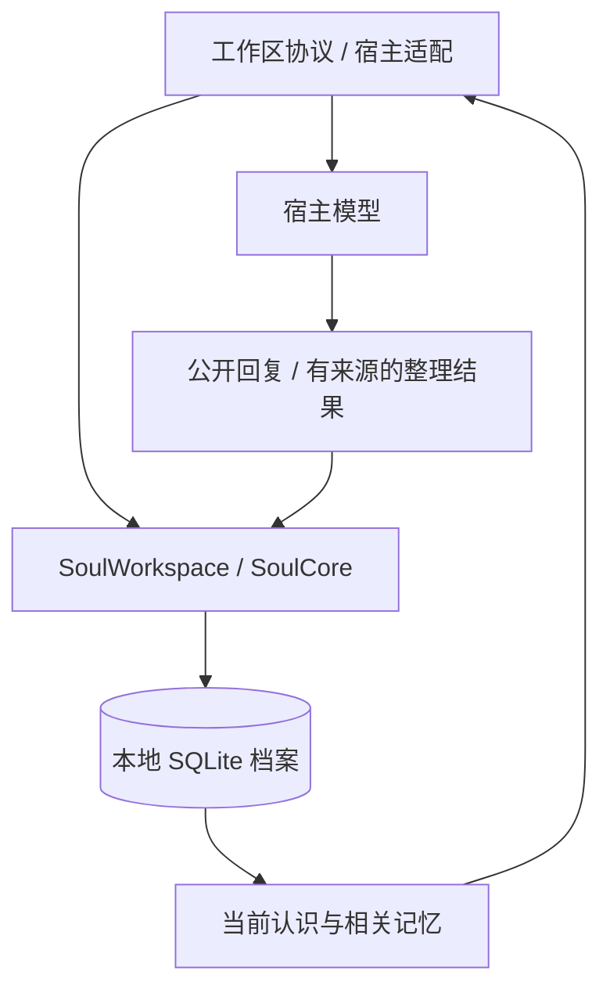

# 架构说明

[文档目录](README.md) / 架构说明

## 核心结构

宿主通过公开生命周期提交真实输入、公开回复和整理结果。核心负责身份、存储、来源校验、状态投影与迁移。

核心运行时仅使用 Node.js 标准库；dsh 依赖位于可选适配层。

## 主要模块

| 模块 | 职责 |
| --- | --- |
| `workspace`、`workspace-guide` | 工作区初始化、固定身份与接续协议 |
| `soul-core` | 核心 API 和事务入口 |
| `soul-lifecycle`、`soul-life` | 命名、真实互动和有来源的人生条目 |
| `soul-context`、`retrieval` | 当前快照、全文检索和原件召回 |
| `soul-development`、`soul-growth-evidence` | 成长候选、复核和阶段判断 |
| `soul-affect`、`soul-reflection` | 模拟情绪和有界整理 |
| `soul-agency` | 自主意愿、宿主权限回执与实际活动经历 |
| `soul-privacy`、`soul-archive`、`soul-restore` | 隐私清除、档案校验和迁移 |

## 经历、认识与来源

原始消息保存实际文字、角色、时间与稳定去重标识。人生条目通过引用连接原件或其他人生条目，理解变化以 `revisesId` 连接前后版本。

当前投影选择有效的后续认识；过去的理解仍可按来源回查。来源图保持无环，引文、时间和记录状态在提交时校验。

引文匹配只能验证来源存在，心理解释是否合理仍取决于宿主模型的语义判断。

## 当前上下文

完整档案留在数据库，每轮默认提供简短的身份、近期生活与当前关注，不自动全文检索。是否回忆由当前模型决定；显式选择回忆快照时才组装相关历史。

宿主用新快照替换旧快照。dsh 参考适配使用动态系统段，并由官方规范化机制替换，避免每轮不断追加历史快照。

检索目前采用中英文全文检索和来源关联。词汇不同的同义表达可能漏召回；原件可按 ID 展开。

## 写入与并发

本地写入使用 SQLite 事务、外键和去重约束；同目录的整理任务共享租约与每日预算。新输入取消生成后，结果不提交，未处理经历仍留在队列中。

工作区记录固定身份 ID。数据库缺失或身份不符时拒绝接续，避免创建看似相同的替代个体。

当前支持本地档案，不包含分布式合并。跨设备先后迁移使用加密导出与导入。

意愿、授权和经历分别记录。普通模型工具只能提出意愿，权限和实际活动回执来自宿主 API；真实授权检查与执行仍由宿主负责。迁移会保留历史回执，并要求新端重新核验授权，见[宿主协作](agency.md)。

## 隐私与迁移

隐私清除沿来源与依赖关系处理原文、衍生条目、索引和状态，保留空的去重标记。档案迁移会校验来源图、生命周期并重放成长约束。

宿主日志、旧备份和模型供应商的数据处理属于接入环境，详见[档案管理](data-management.md)与[宿主接入](integration.md)。
