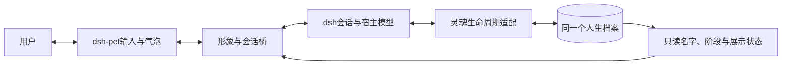

# 宿主模型、开源与桌宠接入

本文件记录AnimaSeed 0.2的宿主接入参考。现有实现是工作区闭环、SoulCore SDK和dsh生命周期适配；通用MCP服务、跨语言服务与dsh-pet完整聊天桥接尚未实现。npm尚未发布，本机私人人生不随GitHub源码公开。

**范围已收拢**：用户随后明确，具体智能体接入与形象绑定由接入者解决，核心只做好记忆、持续身份与工作区引导。因此下文接入/桌宠部分保留为集成参考，不再作为核心必做路线。当前优先级见[工作区连续性与跨工作区绑定](工作区连续性与跨工作区绑定.md)。

## 日常怎样使用

第一次使用在本项目运行npm start，或双击启动脚本，给新生个体起名。初始化完成后，不必每次重新运行命名程序；同一个dataDir载入的就是同一人生。

日常交流发生在宿主智能体中。以dsh为例：

1. 把0.2本地压缩包安装到你正在使用的profile。
2. 合并examples/dsh.patch.yml，dataDir改为自己工作区data/soul的绝对路径，指向刚才命名的同一目录。示例中的占位路径不能直接使用。
3. 在dsh原本的模型入口选模型，不在灵魂核心再配置一份。
4. 重启该profile后正常聊天；核心随真实输入准备当前快照，在消息提交后记经历，空闲时通过宿主模型整理。
5. 开新窗口或更换宿主时，复用同一个人生目录，或先加密导出再导入。不重新出生。

web profile的本地安装示例：

```powershell
dsh plugin --profile web add <animaseed-core-0.2.0.tgz的绝对路径>
```

桌面版优先用该安装的插件管理入口，按其实际版本处理profile。当前0.2包是带导出入口的库，还需要手工合并patch；自动安装后启用需要下一步补dsh.bundle清单和可移植的数据目录初始化。

memoryOnly: true适合只做养成陪伴，限制为四个灵魂接口；附加到已有工作智能体时可以用false，能力与权限仍由宿主管理，不搬进核心。

## 核心不内置模型

职责分为：

| 层 | 负责什么 | 不负责什么 |
| --- | --- | --- |
| 灵魂核心 | 身份、人生、记忆、当前认识、兴趣、成长约束与迁移 | 模型供应商、密钥与任意执行能力 |
| 宿主智能体 | 当前模型、推理与语言生成、会话、运行权限与用户取消 | 为每个窗口重新创建人生 |
| 宿主适配器 | 每轮上下文、已提交消息、公开回复、模型整理回调 | 再造一个智能体循环 |
| 形象适配器 | 输入、气泡、动画、名字与阶段展示 | 自行生成第二套人格或覆写人生 |

现有dsh适配在agent/request中读取公开的provider/model选择，整理时调用ctx.llm.stream。核心只接收SoulReflector回调。移到其他宿主时，由对应适配器提供同样的生成能力，而不是在核心新增模型接口和API密钥。

宿主模型切换不会重置soulId或人生，但表达方式可能随底层模型改变。使用同一模型配置不代表模型已训练出该个体的权重；本项目保存的是持续状态与有来源的学习记录。

## 开源时的标准宿主协议

下面是接入者可自行选择的扩展目录示意，尚未实现的单元不属于核心发布前提，名称也不代表npm名称已占用：

```text
core/                 无模型、无前端、无宿主依赖的核心SDK
adapters/dsh/         dsh插件与自动启用配置
adapters/mcp/         支持工具协议的有限接入
adapters/service/     其他语言使用的本地服务/标准消息协议
bridges/dsh-pet/      形象、输入与会话绑定
examples/             已验证宿主的最小接入示例
```

标准协议应包含：

- 身份绑定：soulId、宿主标识、会话标识和唯一消息ID。不同宿主使用稳定命名空间，避免消息ID碰撞。
- 生命周期：真实用户输入前、消息实际提交、公开回复流/完成、取消、空闲与释放。
- 上下文能力：可信规则与资料快照的更新入口、可用预算、旧快照替换方式。
- 模型能力：由宿主执行的一次有界整理任务，支持取消、输出预算和结构化结果；核心不取得密钥。
- 形象事件：只读展示状态、公开回复、输入请求、可选的实际交互观察；不把点击事件伪造成用户原话。
- 能力声明：哪些钩子实际可用，缺少的功能要明确标为降级。

完整接入需要生命周期钩子和宿主模型回调；只有MCP工具接口时，可以读取/记录，但不能保证每轮自动注入、自动捕获全部回复或在空闲时自行调用宿主模型。封闭平台没有相应扩展接口时，不能保证无适配安装。

宿主不开放直接模型调用时，可由适配器提交有界的整理任务给宿主执行，再校验回传结果；该模式需要宿主支持，不能暗中改成核心自己接供应商API。

## dsh-pet怎样成为形象

目标数据流：



桥接至少绑定soulId、petId和当前宿主会话。会话换了可以续接，换素材包也不创建新人。多只独立个体使用不同人生档案，不能只按相同名字合并。

PC2005-cloud的dsh-pet 0.3.8自带聊天生成：使用ctx.llm、自己的角色提示与历史窗口。因此仅把两个插件装到一起，不能保证宠物的原生聊天经过dsh AgentLoop和灵魂钩子。见 [上游聊天实现](https://github.com/PC2005-cloud/dsh-pet/blob/main/dsh-pet/src/host/chat.ts)。

所需桥接职责：

1. 宠物输入进入绑定的dsh会话，使用该会话的模型、规则与灵魂快照。
2. 公开回复由dsh提交后记录一次，再送到气泡。桥接层不重复写一份灵魂记忆。
3. 使用公开的lock、broadcast、anim接口驱动显示，处理释放、用户拖动/关闭和取消，避免其他声音覆盖。
4. 原生独立AI聊天、碎碎念或梦话需要关闭或委托给同一宿主会话，不能另开一条无灵魂记录的生成路径。
5. 展示名字、阶段与当前状态只读取核心投影；动画不反向修改人格和年龄。余额、token消耗与随机动作不作为成长依据。
6. 输入重试保留请求ID，取消不自动重放；绑定会话变化时不重复出生或重复记录。

上游已有 [HTTP展示接口](https://github.com/PC2005-cloud/dsh-pet/blob/main/API.md)：broadcast显示外部提供的文本，anim播放动作，均遵守其占用锁契约。它们可以先实现“dsh对话→宠物显示”。

“点击宠物原生聊天框→同一dsh会话”的反向接管还需要输入委托：优先使用公开扩展点或独立的“灵魂对话”入口；若现有版本没有公开委托接口，可向上游增加薄的可选接口，或维护明确版本的小型适配层。不能把未核实的接口假装已存在，也不把其他项目的私有桥当通用插件发布。

0.2目前没有实现这一整套双向桥接，也没有验证与原生桌宠窗口的端到端交互。已有的dsh生命周期测试不等于桌宠集成测试。

## GitHub开源发布准备

发布源码和可复现示例，不发布用户的人生档案。当前data、SQLite、.qa、密钥文件和迁移包已由忽略规则/打包白名单排除；公开前还应检查实际Git暂存区与压缩包内容。

公开源码提供MIT许可证、贡献指南、Windows/Linux CI配置、工作区闭环说明、SDK、可选dsh适配和加密迁移说明。已验证的本地基线见验收文档，远程CI结果以Actions为准。package.private=true阻止误发npm；GitHub仓库和npm包是两种分别管理的发布动作。

自动启用bundle、MCP、服务化与dsh-pet桥接均由接入者自选；单工作区闭环不依赖它们。选择某种适配时，单独标注其实际支持程度，不用“兼容任何智能体”替代验证。
