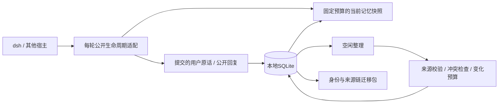

# 架构与边界

本文保留0.1记忆基础层的历史设计。0.2当前实现见 [0.2实现与验收.md](0.2实现与验收.md)。新版使用SoulCore和schema2，dsh当前快照通过动态系统段及官方规范化机制替换；下文0.1的自动命名、四维人格与systemPrompt.context策略不代表新版行为。

数据目录属于一个持续身份，窗口和宿主只是访问者。身份ID由首次初始化随机生成，之后只能通过完整迁移沿用。核心不依赖 dsh、Electron、网络或模型厂商，运行时只用 Node 标准库。

| 层 | 实现 | 时间尺度与依据 |
| --- | --- | --- |
| 工作记忆 | 当前用户问题、最近经历、未结束话题 | 每轮更新，有固定字符预算 |
| 情景记忆 | 用户/助手原始发言，来源和时间不可覆盖 | 提交后立即落盘；同一消息去重 |
| 语义与自传 | fact/habit/autobiography/commitment/reflection/summary | 整理有引文和置信度，冲突需显式纠正 |
| 关联召回 | 中英文全文检索、证据图一跳扩展 | 本地执行；没有把每轮输入发送给远程向量模型 |
| 人格 | 不变基线 + 有证据的变化事件 | 每项至少跨两天三条经历，单维每天绝对变化总量≤0.03 |
| 情绪与关系 | valence/arousal/trust 的有来源评估 | 衰减半衰期分别为6小时/3小时/90天 |
| 选择性遗忘 | 低重要性时间衰减、30天小事退出召回、明确到期与显式遗忘 | 来源失效传播到全部衍生内容 |

这些数值是第一版可测试的工程参数，**不代表人脑的精确生理参数**。基线不会因一句话被改写。离线时间只影响衰减，不生成虚构的经历、感受或“做梦故事”。

## 来源与一致性

`nodes` 保存记忆，`sources` 保存证据依赖，`changes` 与 `appraisals` 保存人格与情绪评估，`meta` 保存身份。`audit` 只记操作、ID和时间，不复制被遗忘的正文。全文索引可由有效记录重建。

写入使用 SQLite `BEGIN IMMEDIATE` 事务、外键、2秒锁等待与完整同步。多个窗口共享本地数据库的写锁，避免各存一份身份；读写同步操作仅用于短的本地工作。第一版没有分布式锁、跨设备合并或大规模后台队列。

任何状态投影都检查其证据是否仍有效；明确到期在查询前处理。人格和事实只能引用用户原始发言，助手自行生成的内容不能成为它们的证据。摘要可以引用已有整理记忆，依赖图必须无环。

逐字引文能证明来源存在，不能自动证明“引用这句话就足以支持模型写出的结论”。模型整理结果依然可能有语义错误，用户可通过读取、纠正和遗忘检查；第一版不声称已解决所有幻觉。

遗忘从目标向上寻找全部来源，再向下清理所有衍生项，抹去正文、引文、实体、语义键，删除关联人格/情绪评估；开启 `secure_delete` 并执行 VACUUM 清理本地空闲页。墓碑只保留去重与状态所需的ID元数据。这里的“清除”不等同于保证SSD物理介质不可恢复，也不能删除外部副本。

自动淡出主要是停止召回，过期原件仍保留在数据库中供本地审计。只有显式遗忘清除正文。用户不希望长期保留的小事，可调用 forget；默认30天是一项保留策略，不是对全部数据的销毁承诺。

## dsh 适配

兼容基线是 0.2.1-rc.2，源于该版本公开类型和 [官方插件扩展文档](https://github.com/deepseek-ai/deepseek-harness/blob/master/docs/cookbook/extension-cookbook.md)。

- `agent/pre-step` 中识别 `source.kind === 'user'`，为本轮准备一次本地召回。
- `systemPrompt.context` 提供当前快照，由官方会话机制管理更新，不逐步追加重复记忆。
- `session/event` 只保存已提交的真实用户消息和非中断的助手公开文本。拒绝步骤、思考、工具结果、合成注入与继承事件不当成用户新经历。
- `turn/end` 完成后启动空闲计时；缺省120秒后做本地整理，配置宿主整理模型后再做一次有界生成。
- `agent/inbox/inserted` 的新用户输入取消后台生成；提交前再检查取消信号和证据有效性。
- 只暴露三个记忆工具。`memoryOnly` 用 `agent.ctx.tools.restrict()` 对根会话限制可见和可执行工具，子智能体不获取私人记忆。
- 插件卸载取消并等待后台任务，释放作用域和数据库。

空闲整理会在近期最多24条用户经历中工作，不意味着每段历史都会自动形成完整自传。第一版未装语义向量模型，词汇完全不同的同义表达可能漏召回；原件仍在，可精确检索或使用可选整理生成更易检索的事实与关联词。

## 后续边界

1. 加入可选本地嵌入和离线索引构建，保留无需网络的快速路径，测量中英文跨表述召回率。
2. 带持久游标的分批回放、可检查的自传压缩、矛盾证据并存和片段级纠正/遗忘。
3. 建立跨月和跨年的行为评测：事实更新、时间推理、拒绝编造、关系边界、人格稳定性、成长质量。
4. 旧项目数据先做只读映射和迁移预览，再导入新身份或继承指定身份；不搬旧执行能力。
5. 为其他宿主提供生命周期适配；只有工具接口的平台，需要明确列出接入限制。

人脑相关研究只用作机制启发，例如 [互补学习系统](https://pubmed.ncbi.nlm.nih.gov/7624455/) 与 [遗忘的功能](https://pubmed.ncbi.nlm.nih.gov/28641107/)。不能把这些论文当成“本项目已具有人类意识”的证明。
